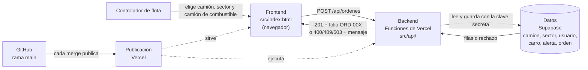

# Arquitectura y PoC · Monitor de combustible de flota autónoma (Equipo 3)

Prueba de concepto (PoC) de la historia **HU-04**: el controlador de flota asigna la orden de reabastecimiento al operador del camión de combustible, indicando el camión y el sector de encuentro. La orden queda guardada de verdad en la base de datos y la pantalla muestra su folio.

## Diagrama de componentes

| Pieza | Qué hace en nuestra solución | Con qué está hecha | Con quién se comunica |
|---|---|---|---|
| Frontend (navegador) | Muestra el formulario «Asignar orden» con tres listas obligatorias (camión, sector de encuentro y camión de combustible), avisa si falta un campo, bloquea el doble clic y muestra el folio o el error sin borrar lo elegido. | Página web (`src/index.html`) hecha con el agente de IA (Claude), sin librerías. | Le pide las listas a `/api/opciones` y le envía la orden a `/api/ordenes`; recibe el folio o un mensaje de error. |
| Backend (servidor) | Vuelve a validar todo lo que llega, aunque la pantalla ya lo haya revisado: campos obligatorios, que el camión, el sector y el camión de combustible existan, que este último esté disponible, que el camión tenga una alerta activa y que esa alerta no tenga ya una orden. Si algo no cumple, no guarda nada. | Funciones del servidor en Vercel (`src/api/ordenes.js`, `src/api/opciones.js`). | Recibe la orden del frontend; consulta y guarda en Supabase con la clave secreta, que vive solo en las variables de Vercel. |
| Datos | Guarda las órdenes y genera el folio (ORD-001, ORD-002…). Es la última barrera: rechaza obligatorios vacíos, estados fuera de lista, claves que no existen y una segunda orden para la misma alerta. | Supabase (Postgres). Tablas: `camion`, `sector`, `usuario`, `carro`, `alerta`, `orden` (`src/db/esquema.sql`), según `docs/datos/estructura_datos.md`. | Solo habla con el backend. El navegador no puede entrar directo: las tablas tienen seguridad por filas activada y sin permisos públicos. |
| Servicio externo | Ninguno. Los sensores de combustible quedan fuera de la PoC: los niveles son datos de ejemplo cargados en Supabase. | Ninguno. | — |
| Publicación | Publica la página y las funciones del servidor desde la rama `main`, en una dirección pública que abre sin iniciar sesión. | Vercel conectado a GitHub (carpeta raíz `src`). | Toma el código de GitHub en cada merge a `main`; entrega las variables de entorno al backend. |

### Plan de falla del servicio externo

No usamos un servicio externo; la pieza de la que dependemos es **Supabase**. Si no responde (caída, pausa del proyecto gratuito o variables mal puestas):

- El backend espera como máximo 8 segundos, no guarda nada a medias y responde **503**.
- La pantalla muestra: «No pudimos guardar la orden porque la base de datos no responde. Lo que eligió sigue en el formulario: reintente en unos segundos o avise al operador por radio.» Lo elegido no se borra.
- Si falla al abrir la página, muestra «No se pudieron cargar los datos» con un botón **Reintentar**.
- En la operación real, el respaldo es la radio, como hoy.

## Camino delgado

**Acción:** asignar la orden de reabastecimiento (HU-04): elegir camión, sector de encuentro y camión de combustible → el servidor valida → se guarda en Supabase → la pantalla muestra el folio.

**Por qué es lo más frágil:** es la única acción del flujo que escribe datos. Depende de las tres piezas a la vez (pantalla, servidor y base de datos). Un error ahí deja a un camión sin combustible o con dos órdenes que mandan al operador a dos lugares. Las otras historias solo leen o dependen de que esta orden exista.

**Queda fuera por ahora:**
- El monitor y el detalle (HU-01, HU-02 y HU-03) y el cierre de la orden (HU-05). Siguen simulados en el [prototipo](https://grupo-3-electivo-ia-prototipo.vercel.app/).
- La conexión con los sensores reales. Los niveles son datos de ejemplo.
- El inicio de sesión y los roles. La orden queda a nombre de un controlador de ejemplo fijo (`USR-01`).
- El aviso al operador en su equipo y la reasignación.

**Si algo falla, la persona:**
- Ve un mensaje claro junto al campo con problema o arriba del formulario, conserva lo que eligió y puede reintentar.
- Si el camión ya tenía orden, se le dice cuál es (no se crea otra).
- Si la base de datos no responde, se le indica avisar por radio.

### Casos de error que el servidor rechaza

| Intento | Respuesta | Mensaje |
|---|---|---|
| Campo vacío (o enviado sin la pantalla) | 400 | «Elija el camión que necesita combustible.» (uno por campo) |
| Texto larguísimo en un campo | 400 | Mismo mensaje del campo; no se guarda |
| Camión de combustible fuera de servicio (CAR-02) | 400 | «Ese camión de combustible no está disponible. Elija uno disponible.» |
| Camión sin alerta activa (CAM-03) | 400 | «CAM-03 no tiene una alerta activa: no corresponde asignarle una orden.» |
| Doble envío / segunda orden para el mismo camión | 409 | «CAM-07 ya tiene la orden ORD-001 registrada. No se creó otra.» |
| Base de datos sin respuesta | 503 | Mensaje del plan de falla |

Para probar que la validación está en el servidor y no solo en la pantalla, se abre la dirección con `?prueba` al final. En ese modo la pantalla deja elegir todo, incluido CAR-02 fuera de servicio, y es el servidor el que rechaza la orden.

## Evidencia

- **Dirección pública:** PENDIENTE (pegar el enlace de Vercel)
- **Video (1–2 min, pantalla y voz):** PENDIENTE (pegar el enlace con acceso para la profesora)
- **Caso de error probado:** en `…/?prueba` se eligió CAM-12 + SEC-A + CAR-02 (fuera de servicio). El servidor respondió 400 «Ese camión de combustible no está disponible», y en Supabase (Table Editor → `orden`) no apareció ninguna fila nueva.
