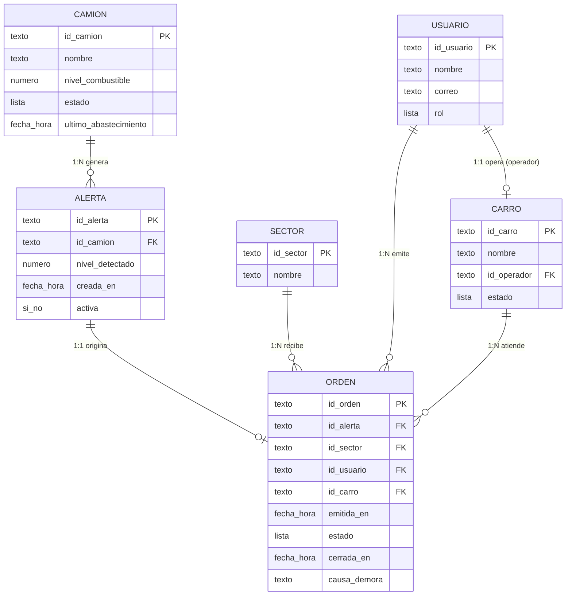

# Estructura de datos

## 1. Diagrama de la base de datos

Listas de valores:
- CAMION.estado: normal, alerta, critico, sin_senal, en_proceso, abastecido
- USUARIO.rol: controlador, supervisor, operador
- ORDEN.estado: emitida, en_proceso, reasignada, cerrada
- CARRO.estado: disponible, ocupado, fuera_de_servicio

## 2. Campos obligatorios y ejemplos

`*` = obligatorio (no puede quedar vacío).

### CAMION
| id_camion* | nombre* | nivel_combustible* | estado* | ultimo_abastecimiento |
|---|---|---|---|---|
| CAM-30 | Camión 30 | 96 | abastecido | 2026-09-30 21:10 |
| CAM-19 | Camión 19 | 14 | en_proceso | 2026-09-30 20:30 |

### SECTOR
| id_sector* | nombre* |
|---|---|
| SEC-B | Sector B |
| SEC-A | Sector A |

### USUARIO
| id_usuario* | nombre* | correo* | rol* |
|---|---|---|---|
| USR-01 | Controlador Turno A | controlador.a@ejemplo.cl | controlador |
| USR-02 | Supervisor Turno A | supervisor.a@ejemplo.cl | supervisor |
| USR-03 | Operador camión de combustible A | operador.a@ejemplo.cl | operador |
| USR-04 | Operador camión de combustible B | operador.b@ejemplo.cl | operador |

### CARRO
| id_carro* | nombre* | id_operador* | estado* |
|---|---|---|---|
| CAR-01 | Camión de combustible 1 | USR-03 | ocupado |
| CAR-02 | Camión de combustible 2 | USR-04 | fuera_de_servicio |

### ALERTA
`nivel_detectado` es opcional: queda vacío cuando la alerta es porque el sensor no reporta (extensión E1).

| id_alerta* | id_camion* | nivel_detectado | creada_en* | activa* |
|---|---|---|---|---|
| ALR-001 | CAM-30 | 12 | 2026-10-01 09:42 | no |
| ALR-002 | CAM-19 | 14 | 2026-10-01 09:44 | sí |

### ORDEN
`cerrada_en` es opcional: queda vacío hasta que se cierra el reabastecimiento. `causa_demora` es opcional: se llena solo si la orden se reasigna porque el carro no está disponible (extensión E2).

| id_orden* | id_alerta* | id_sector* | id_usuario* | id_carro* | emitida_en* | estado* | cerrada_en | causa_demora |
|---|---|---|---|---|---|---|---|---|
| ORD-001 | ALR-001 | SEC-B | USR-01 | CAR-01 | 2026-10-01 09:45 | cerrada | 2026-10-01 10:05 | |
| ORD-002 | ALR-002 | SEC-A | USR-01 | CAR-01 | 2026-10-01 10:08 | en_proceso | | |
