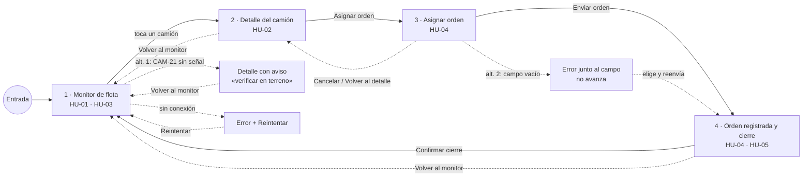

# Prototipo navegable · Monitoreo de combustible de flota autónoma

Enlace: **[pendiente: pegar aquí el enlace de producción de Vercel]** (accesible sin iniciar sesión; probado en ventana de incógnito)

Código: [`prototipo/index.html`](../prototipo/index.html). Datos de ejemplo con los nombres de [`docs/datos/estructura_datos.md`](datos/estructura_datos.md).

## Sistema mínimo (A2)

Texto: **24 px** (títulos y cifras) y **16 px** (contenido) · Acción: **azul #1D4ED8** · Alerta: **rojo #B42318** · Espaciado: **8 px**

Cada pantalla tiene una sola acción primaria (botón azul relleno); las secundarias van con borde. Los estados siempre llevan texto (Crítico, Sin señal, En proceso, Abastecido), nunca solo color.

## Mapa de navegación (A3)

Línea llena: ruta principal. Línea punteada: retornos y caminos alternativos. En todas las pantallas, la ruta de arriba («Monitor de flota › CAM-07 › …») indica dónde se está y permite volver; P2, P3 y P4 tienen además un botón de volver visible.

Caminos alternativos (los dos se pueden recorrer en el prototipo):
1. **Derivado del criterio de HU-01:** CAM-21 aparece con estado «Sin señal», su último nivel marcado como no confiable y el aviso «Verificar en terreno antes de decidir», nunca como camión normal.
2. **Campo vacío:** en Asignar orden, si se envía sin sector o sin camión de combustible, aparece el error junto al campo con cómo corregirlo y la orden no se envía. Además: **Cancelar** vuelve al detalle, y **sin conexión** (barra de revisión) muestra el error con Reintentar.

## Estados (A4)

| Estado | Dónde verlo |
|---|---|
| Con datos | Monitor al cargar |
| Cargando | Monitor al abrir (lecturas) y «Registrando orden…» al enviar |
| Vacío | Barra de revisión → «Vacío»: «Ningún camión requiere atención» |
| Error | Barra de revisión → «Sin conexión»: error en el monitor con Reintentar, y error al enviar la orden |

La barra inferior «Revisión del prototipo» solo sirve para mostrar estos estados durante la evaluación; no es parte de la aplicación.

## Formulario (A4)

| Decisión | Cómo se aplica en Asignar orden |
|---|---|
| Solo campos justificados | Camión (`CAMION.id_camion`), Sector de encuentro (`SECTOR` → `ORDEN.id_sector`) y Camión de combustible con su operador (`CARRO` → `ORDEN.id_carro`). Todos los pide HU-04. |
| Etiqueta visible | Cada campo tiene su etiqueta arriba, siempre visible. |
| Error junto al campo | Mensaje en rojo bajo el campo, con cómo corregirlo; el cursor vuelve al primer campo con error. |
| Precargar u ofrecer opciones | El camión viene precargado; sector y carro se eligen de una lista; los carros fuera de servicio no se pueden elegir. |

## Registro de decisiones (A5)

| Pantalla | Historia | Criterio que verifica | Simulado | Funcional |
|---|---|---|---|---|
| P1 · Monitor de flota | HU-01, HU-03 | Principal: camiones bajo 15 % primero, con código, nivel y estado «Crítico». Alternativo: CAM-21 «Sin señal» con aviso, no como normal. | Lecturas de los sensores (datos de ejemplo), tiempo de carga | Navegación, cifras calculadas de los datos, estados vacío / cargando / error, Reintentar |
| P2 · Detalle del camión | HU-02 | (HU-02 sin criterios en este avance) | Historial de alertas y último abastecimiento (datos de ejemplo) | Navegación, aviso para camión sin señal, botón según si ya hay orden |
| P3 · Asignar orden | HU-04 | (sin criterios en este avance) | Envío a la base de datos y aviso al operador | Validación de campos, errores junto al campo, carros fuera de servicio bloqueados, Cancelar, error sin conexión |
| P4 · Orden registrada y cierre | HU-04, HU-05 | (sin criterios en este avance) | Registro de la orden y del cierre (en memoria del navegador) | Confirmar cierre cambia la orden a «Cerrada», el camión a «Abastecido» y lo saca de «Requieren atención» |
