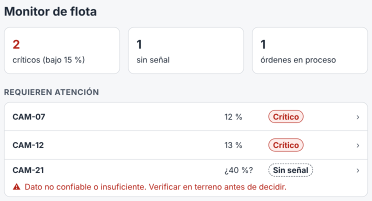
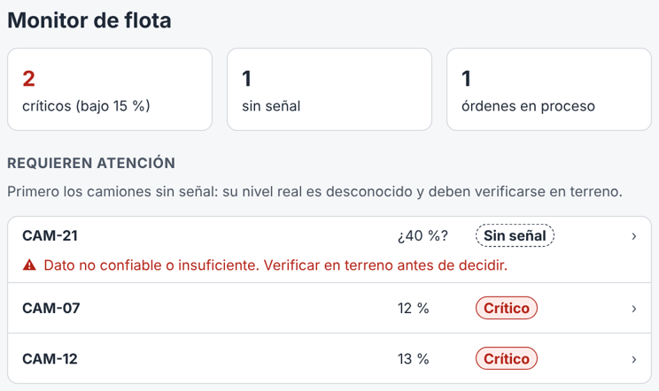

# Análisis ético del prototipo · Monitoreo de combustible de flota autónoma

Analizamos el prototipo de [docs/prototipo.md](prototipo.md): sus 4 pantallas, el formulario «Asignar orden» y la regla que ordena la lista «Requieren atención».

## B1 · Mapa de impacto y exclusión

| | Quien ejecuta la tarea: **controlador de flota** | Quien decide o supervisa: **jefe de turno** | Quien queda excluido: **operador del camión de combustible** |
|---|---|---|---|
| **Deja de hacer** | Revisar camión por camión y anotar los abastecimientos bajo un registro sin sistema centralizado. | Reconstruir lo que pasó en el turno a partir de registros inconsistentes. | Nada: no usa la aplicación directamente. Sigue recibiendo las órdenes por radio y no tiene cómo responder dentro del sistema. |
| **Su rol se redefine en** | Verificar si la lectura es coherente, atender los camiones «sin señal» y confirmar los cierres. | Revisar las órdenes y los cierres del turno, y las alertas que nadie atendió. | Ejecutar órdenes que otro registra por él: su llegada, su demora o un carro fuera de servicio solo quedan si el controlador los anota (`causa_demora`). |
| **Riesgo si nadie lo asume** | Confiar en la lista sin mirar los avisos: un camión sin señal puede detenerse aunque «no aparezca crítico». | Las alertas sin atender se repiten turno a turno sin que nadie responda por ellas. | Una orden queda «en proceso» aunque nunca le llegó, y la detención se le atribuye a él sin que pueda dar su versión. |

Quedan fuera de los datos también los **camiones cuyo sensor no reporta**: no tienen nivel confiable, así que la regla de priorización no los ve igual que al resto (ver B3).

## B2 · Ficha de tratamiento de datos personales

Una fila por cada campo del formulario «Asignar orden» (P3). Los plazos de conservación son una propuesta del equipo, a validar con la empresa.

| Campo del formulario | Dato guardado | Finalidad (historia) | ¿Dato personal? | Quién accede | Cuánto tiempo se conserva |
|---|---|---|---|---|---|
| Camión | `CAMION.id_camion` (vía `ORDEN.id_alerta`) | HU-04: saber a qué camión va la orden | No | Controlador, jefe de turno; operador se entera por radio | Mientras exista el historial de órdenes (12 meses) |
| Sector de encuentro | `ORDEN.id_sector` | HU-04: indicar dónde se encuentran el camión y el carro | No | Controlador, jefe de turno, operador asignado | 12 meses |
| Camión de combustible y operador | `ORDEN.id_carro` → `CARRO.id_operador` → `USUARIO.nombre` | HU-04: a quién le llega la orden; HU-05: quién informa el término | **Sí** (nombre del operador) | Controlador y jefe de turno; el operador ve solo sus propias órdenes | 12 meses; luego se conserva la orden sin el nombre del operador |

Registrados sin que el controlador los escriba: `ORDEN.id_usuario` (quién emitió la orden, **dato personal**, finalidad HU-04), `ORDEN.emitida_en` y `ORDEN.cerrada_en` (HU-05).

**Privacidad desde el diseño:** el formulario no pide teléfono, RUT ni correo del operador, porque ninguna historia los necesita. `USUARIO.correo` existe en la estructura de datos, pero ninguna pantalla lo usa; queda marcado para eliminarlo o justificarlo cuando definamos el inicio de sesión.

## B3 · Sesgo, accesibilidad y transparencia

**Accesibilidad, revisada sobre las pantallas del prototipo**

| Aspecto | ¿Cumple? | Evidencia en el prototipo |
|---|---|---|
| Contraste texto/fondo | Sí | Texto principal 14,7:1; texto gris 7,6:1; botón (blanco sobre azul) 6,7:1; texto de alerta rojo 6,6:1. Todos sobre el mínimo de 4,5:1. |
| Elementos interactivos de al menos 24 × 24 px | Sí | Los botones miden al menos 44 px de alto (los principales, 48 px). Lo más pequeño son los enlaces de la ruta («Monitor de flota › CAM-07»): 63 × 24 px, justo en el mínimo; es un punto a agrandar en la próxima versión. |
| Estados expresados con texto, no solo color | Sí | Cada estado lleva su palabra: «Crítico», «Sin señal», «En proceso», «Abastecido», «Normal». «Sin señal» usa además borde punteado y el símbolo ⚠. |
| Etiquetas visibles | Sí | Los tres campos de «Asignar orden» tienen su etiqueta arriba, siempre visible; los errores aparecen bajo el campo con cómo corregirlos. |

**A quién relega la regla de priorización.** La lista «Requieren atención» se ordenaba por nivel de combustible, de menor a mayor. Un camión sin señal guarda su último nivel conocido (CAM-21: 40 %), así que quedaba **al final**, después de todos los críticos, aunque su nivel real es desconocido y podría estar más bajo que cualquiera. Con muchos camiones críticos, el que más incertidumbre tiene quedaría fuera de la vista. Ese hallazgo motivó el cambio de abajo.

**Inteligencia artificial:** no aplica. El prototipo no usa IA para sugerir ni decidir: la lista se ordena con una regla fija (estado y nivel) y cada orden la emite el controlador. Si más adelante se agrega una sugerencia automática, se indicará en pantalla y la decisión seguirá siendo del controlador.

## B4 · Sostenibilidad y riesgos

**Prácticas de uso eficiente de recursos**
1. El prototipo es una sola página de 24 KB, sin librerías ni imágenes: carga rápido incluso con mala cobertura en la mina.
2. El monitor muestra solo los camiones que requieren atención y un conteo del resto, en vez de traer la flota completa: al conectar la base de datos, consultaremos únicamente esos campos.
3. Usamos solo el despliegue de producción en Vercel y comprimimos las imágenes del repositorio (las capturas de este análisis pesan menos de 70 KB cada una).

**Riesgos**

| Riesgo | Tratamiento | Responsable | Se revisa |
|---|---|---|---|
| Una lectura errónea del sensor lleva a no abastecer un camión que sí lo necesitaba. | **Mitigar:** estado «Sin señal», aviso de verificar en terreno y prioridad en la lista. | Ikki Saito | En las pruebas con usuarios (semana 7) |
| La orden no le llega al operador (radio o zona sin cobertura) y queda «en proceso» sin que nadie lo note. | **Mitigar:** el controlador confirma el cierre solo cuando el operador informa; registrar la causa de la demora (E2). | Simón Gallardo | Al conectar la base de datos |
| Se expone el nombre de los operadores a personas que no lo necesitan. | **Mitigar:** acceso por rol; el operador ve solo sus órdenes; no se piden teléfono ni RUT. | Simón Gallardo | Al definir el inicio de sesión |
| Alguien confunde los datos de ejemplo del prototipo con datos reales de la flota. | **Aceptar** mientras sea prototipo: los datos son de ejemplo y lo dice el README. | Ikki Saito | En cada entrega |

## Modificación del prototipo motivada por el análisis

**Hallazgo (B3):** al ordenar por nivel, los camiones sin señal quedaban al final de «Requieren atención», aunque su nivel real es desconocido.
**Cambio:** ahora aparecen primero, con una línea que explica por qué.

| Antes | Después |
|---|---|
|  |  |
