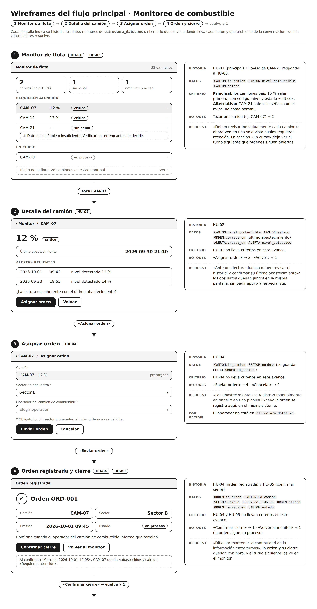

# Wireframes · flujo principal

Flujo: 1 Monitor de flota → 2 Detalle del camión → 3 Asignar orden → 4 Orden registrada y cierre → vuelve a 1.
Historias: [docs/historias.md](../historias.md) · Datos: [docs/datos/estructura_datos.md](../datos/estructura_datos.md)

## Notas por pantalla

**1 · Monitor de flota**
- Historia: HU-01 (principal). El aviso de CAM-21 responde a HU-03.
- Datos: `CAMION.id_camion`, `CAMION.nivel_combustible`, `CAMION.estado`
- Criterio: principal, los camiones bajo 15 % salen primero con código, nivel y estado «crítico». Alternativo, CAM-21 sale «sin señal» con el aviso, no como normal.
- Botones: tocar un camión (ej. CAM-07) → 2
- Resuelve: hoy deben revisar cada camión por separado; aquí ven en una sola vista cuáles requieren atención. «En curso» deja ver al turno siguiente qué órdenes siguen abiertas.

**2 · Detalle del camión**
- Historia: HU-02
- Datos: `CAMION.nivel_combustible`, `CAMION.estado`, `ORDEN.cerrada_en` (último abastecimiento), `ALERTA.creada_en`, `ALERTA.nivel_detectado`
- Criterio: HU-02 no lleva criterios en este avance.
- Botones: «Asignar orden» → 3 · «Volver» → 1
- Resuelve: ante una lectura dudosa revisan el historial y el último abastecimiento; ambos quedan juntos en esta pantalla, sin pedir apoyo al especialista.

**3 · Asignar orden**
- Historia: HU-04
- Datos: `CAMION.id_camion`, `SECTOR.nombre` (se guarda como `ORDEN.id_sector`)
- Criterio: HU-04 no lleva criterios en este avance.
- Botones: «Enviar orden» → 4 · «Cancelar» → 2
- Resuelve: los abastecimientos se anotan en papel o en una planilla Excel; aquí la orden queda registrada en el sistema.
- Por decidir: el operador del camión de combustible no está en `estructura_datos.md`.

**4 · Orden registrada y cierre**
- Historia: HU-04 (orden registrada) y HU-05 (confirmar cierre)
- Datos: `ORDEN.id_orden`, `CAMION.id_camion`, `SECTOR.nombre`, `ORDEN.emitida_en`, `ORDEN.estado`, `ORDEN.cerrada_en`, `CAMION.estado`
- Criterio: HU-04 y HU-05 no llevan criterios en este avance.
- Botones: «Confirmar cierre» → 1 (CAM-07 queda «abastecido») · «Volver al monitor» → 1 (la orden sigue en proceso)
- Resuelve: cuesta mantener la información entre turnos; la orden y su cierre quedan con hora y el turno siguiente los ve en el monitor.
